<!--
  ┌──────────────────────────────────────────────────────────────┐
  │  Oh hey, you opened the source. Respect.                     │
  │                                                              │
  │  Everything animated here is hand-rolled SVG, generated by   │
  │  scripts/build.mjs and rebuilt daily by a GitHub Action.     │
  │  No trackers were harmed in the making of this README.       │
  │                                                              │
  │  ↑ ↑ ↓ ↓ ← → ← → B A                                         │
  └──────────────────────────────────────────────────────────────┘
-->

<div align="center">


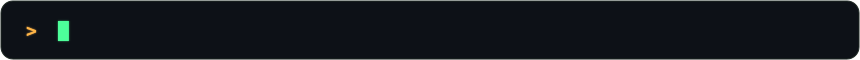

<br/>

<!-- HERO_LINKS:START -->
<a href="https://www.richabh.com/">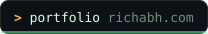</a>
<a href="https://www.richabh.com/contact">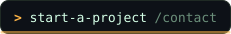</a>
<a href="mailto:work@richabh.com">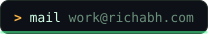</a>
<a href="https://www.linkedin.com/in/richabh-exe">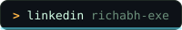</a>
<!-- HERO_LINKS:END -->


</div>

<br/>

## `$ man richabh`

```ts
// ~/.about.ts: compiled daily, never fully debugged
interface Human extends Developer, Tinkerer {}

const richabh = {
  handle:     "richabh-exe",
  based:      "Lucknow, IN  (UTC+05:30)",
  title:      "Creative developer & designer",
  role:       ["Builder", "AI Tinkerer", "Pixel Pusher"],
  building:   "interfaces that feel fast, and agents that do the boring parts",
  learning:   ["TypeScript (the strict kind)", "Node + Express", "React + Next.js"],
  tinkering:  ["LLM agents", "MCP servers", "Claude tooling", "automations"],
  philosophy: "design-driven development: the *why* before the *how*",
  askMeAbout: ["frontend craft", "AI workflows", "turning chaos into checklists"],
  funFact:    "has more terminal tabs open than browser tabs. allegedly.",
} satisfies Human;

export default richabh; // 🚀
```

<br/>

## `$ ls ~/stack --color=always`

<div align="center">

**`./languages`  `./frameworks`**


**`./tooling`  `./infra`**


**`./ai`**


</div>

<br/>

## `$ git log --stat --all`

<div align="center">




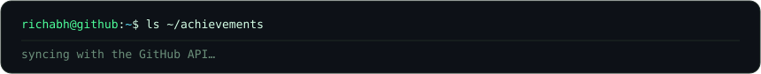

<sub>Every card above is rendered in this repo from the GitHub API by <code>scripts/build.mjs</code>, refreshed every 3 hours.</sub>

</div>

<br/>

## `$ ./snake --eat contributions`

<div align="center">
<picture>
  <source media="(prefers-color-scheme: dark)" srcset="https://raw.githubusercontent.com/richabh-exe/richabh-exe/output/github-snake-dark.svg" />
  <source media="(prefers-color-scheme: light)" srcset="https://raw.githubusercontent.com/richabh-exe/richabh-exe/output/github-snake.svg" />
  
</picture>
</div>

<br/>

## `$ fortune | cowsay`

<!-- FORTUNE:START -->
```text
 ___________________________________________
/ Debugging is twice as hard as writing the \
| code in the first place.                  |
\   — Brian Kernighan                       /
 -------------------------------------------
        \
         \    .-[ ]-.
             | o   o |
             |  ___  |
             '-------'
              /|   |\
```
<sub>rotates daily · last run 2026-10-30</sub>
<!-- FORTUNE:END -->

<br/>

## `$ ./contact.sh`

```bash
#!/usr/bin/env bash
# Pick a channel. All of them route to a human (mostly).
open "https://www.richabh.com/contact"   # start a project
mail "work@richabh.com"                  # replies faster than my CI
gh   issue create --repo richabh-exe/richabh-exe   # say hi, or report a bug in me
```

<div align="center">

<!-- LINKS:START -->
<a href="https://www.richabh.com/"></a>
<a href="https://www.richabh.com/contact"></a>
<a href="mailto:work@richabh.com"></a>
<a href="https://www.linkedin.com/in/richabh-exe"></a>
<a href="https://x.com/_richabh">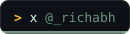</a>
<a href="https://peerlist.io/richabh">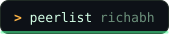</a>
<a href="https://medium.com/@richabh">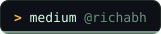</a>
<a href="https://leetcode.com/u/richabh">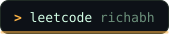</a>
<!-- LINKS:END -->

</div>

<details>
<summary><code>$ sudo rm -rf / --no-preserve-root</code></summary>

<br/>

```text
[sudo] password for visitor: ********
visitor is not in the sudoers file. This incident will be reported. 🚨
```

</details>

<br/>

<div align="center">
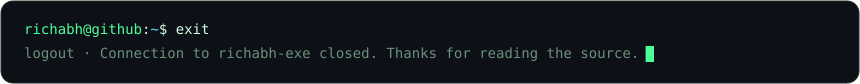
</div>
